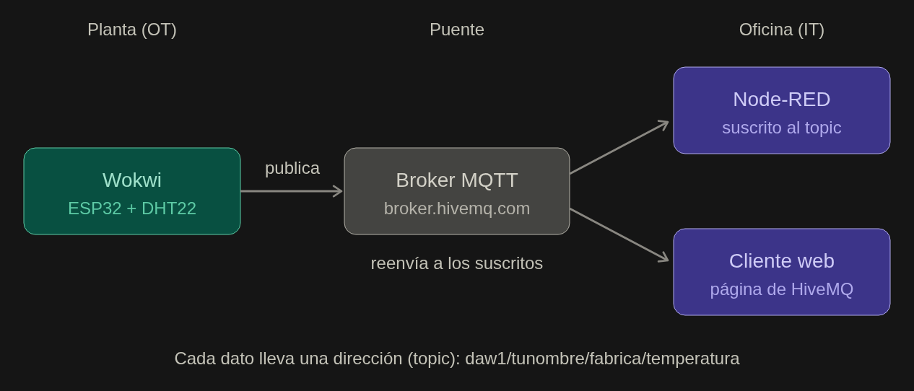

# UT1-A4 · Mini fábrica conectada

[⬇ Descargar práctica en PDF](ut1-a4-mini-fabrica-conectada.pdf){ .md-button .md-button--primary }


## 1. Resultado de aprendizaje, contenido y criterios


<table class="curricular-table">
<tbody>
  <tr>
    <th scope="row" class="curricular-table__label">Resultados de aprendizaje</th>
    <td class="curricular-table__content"><p>RA1. Analiza el concepto de digitalización y su repercusión en los sectores productivos teniendo en cuenta la actividad de la empresa e identificando entornos IT (Information Technology: tecnología de la información) y OT (Operation Technology: tecnología de operación) característicos.</p></td>
  </tr>
  <tr>
    <th scope="row" class="curricular-table__label">Contenido</th>
    <td class="curricular-table__content"><p>4 - Estructura de la empresa.<br>5 - Entornos IT y OT. Convergencia entre entornos IT y OT.</p></td>
  </tr>
  <tr>
    <th scope="row" class="curricular-table__label">Criterios de evaluación</th>
    <td class="curricular-table__content"><p>c) Se han establecido las diferencias y similitudes entre los entornos IT y OT.<br>e) Se han seleccionado las tecnologías típicas de la digitalización en planta y en nego<br>f) Se ha analizado la importancia de la conexión entre entornos IT y OT.</p></td>
  </tr>
</tbody>
</table>

## 2. Agrupamiento y dinámica cooperativa

En pareja

## 3. Contexto

### 1. ¿Qué vas a hacer?

Vas a montar, sin comprar nada y desde tu ordenador, una fábrica en miniatura: un sensor de temperatura virtual que envía sus datos por internet y un panel que los muestra y avisa cuando algo va mal.

En la unidad has visto que una empresa tiene dos mundos: OT (las máquinas y sensores de la planta) e IT (los ordenadores y programas que gestionan la información). En esta práctica vas a construir los dos y, sobre todo, la conexión entre ellos.

### ¿Qué vamos a montar y cómo funciona?

Todo se ejecuta en tu navegador: Wokwi simula el ESP32 y el DHT22 y ejecuta tu código. Cada 5 segundos el código lee el sensor y llama dos veces a mqtt.publish, una con la temperatura en daw1/tunombre/fabrica/temperatura y otra con la humedad en daw1/tunombre/fabrica/humedad. Esos mensajes no van ni a Wokwi ni a Node-RED, sino al broker broker.hivemq.com (puerto 1883). Llegan hasta él por la WiFi virtual Wokwi-GUEST, que da internet a la placa simulada. El topic no hay que crearlo antes: es solo la etiqueta con la que se envía cada mensaje.

Qué hace HiveMQ. HiveMQ es la empresa, y broker.hivemq.com es un broker público y gratuito que ella mantiene. Su trabajo es recibir un mensaje, mirar su topic y enviar una copia a cada cliente que esté suscrito a ese topic en ese momento. No interpreta el valor: para él 27.5 es solo texto. Con este código tampoco lo guarda, así que si nadie está suscrito, el mensaje se pierde. La página «HiveMQ websocket client» es otro cliente más, un suscriptor. Usa WebSocket (puertos 8000 u 8884) porque un navegador no puede abrir una conexión MQTT normal.

Qué es Node-RED y cómo consume los datos. Es un programa que corre en tu ordenador y en el que se programa uniendo cajitas con líneas. Aquí hace de lado IT.

El nodo mqtt in se conecta al broker por el puerto 1883 y se suscribe a tu topic. Node-RED no le pregunta nada al sensor: se limita a escuchar.

Cada mensaje que llega entra en el flujo con el valor en msg.payload y viaja por las líneas hacia el gauge, que mueve la aguja, y hacia el nodo function Alarma, que decide el texto según si pasa de 30 °C.

El panel de http://localhost:1880/ui es una página web que el propio Node-RED sirve y refresca.

### Un dato de principio a fin

- El DHT22 simulado mide, por ejemplo, 27.5 °C.
- El código del ESP32 publica 27.5 en tu topic de temperatura.
- El mensaje llega al broker por internet.
- El broker lo copia a todos los suscritos a ese topic: Node-RED y el cliente web.
- Node-RED lo recibe, mueve el indicador y evalúa la alarma.

Wokwi y Node-RED solo comparten el nombre del topic, así que puedes añadir un segundo panel sin tocar el sensor. Eso es lo que hace útil esta arquitectura al unir los mundos OT e IT. A la vez explica el riesgo de la Parte 6: como el broker es público, cualquiera que conozca el topic puede leer o enviar valores.

## 4. Objetivo

Al terminar sabrás:

- Qué es un sensor y una placa programable, y qué papel tienen en el mundo OT.
- Cómo viajan los datos desde la planta hasta la oficina.
- Cómo se ve esa información en un panel de control del mundo IT.
- Por qué conectar IT y OT es útil, pero también arriesgado (ciberseguridad).

## 5. Enunciado

### Parte 1. Montar el sensor virtual (mundo OT)

En esta parte construyes el «cableado» en Wokwi, un programa que simula placas y sensores en el navegador. No puedes romper nada.

#### Paso 1.1. Crear el proyecto

Entra en [wokwi.com](https://wokwi.com/) e inicia sesión.

Pulsa sobre tu avatar y elige “My projects”

Pulsa en crear un proyecto nuevo y del lado izquirdo elige ESP32 y de lo que se muestra eleige ESP32..

Elige un proyecto de Arduino (por ejemplo, la plantilla «ESP32 Blink»). Después cambiaremos su código.

#### Paso 1.2. Añadir el sensor

En la parte del circuito (a la derecha), pulsa el botón azul + («Add a new part»).

Busca DHT22 y añádelo al circuito.

#### Paso 1.3. Cablear el sensor

Haz clic en un pin del sensor y luego en el pin de la placa al que quieres unirlo. Se dibujará un cable. Conecta así:

| Pin del DHT22 | Pin de la placa ESP32 |
|---|---|
| VCC | 3V3 |
| SDA | D15 |
| GND | GND (cualquiera de los GND) |

El cuarto pin del sensor (NC) no se usa.

#### Paso 1.4. Añadir las librerías

Una librería es código ya hecho que nos ahorra trabajo. Necesitamos tres.

En el editor de código, abre la pestaña `libraries.txt`.

Borra lo que haya y escribe estas tres líneas:

```text
DHT sensor library
Adafruit Unified Sensor
PubSubClient
```

### Parte 2. Programar la placa para que envíe datos

Ahora le decimos a la placa qué hacer: leer el sensor cada 5 segundos y publicar los valores por MQTT.

#### Paso 2.1. Pegar el código

Vuelve a la pestaña `sketch.ino`, borra todo su contenido y pega este código:

```cpp
#include <WiFi.h>
#include <PubSubClient.h>
#include "DHT.h"

// ---------- AJUSTES ----------
const char* WIFI_SSID   = "Wokwi-GUEST";   // WiFi virtual de Wokwi
const char* WIFI_PASS   = "";              // no tiene contraseña
const char* MQTT_SERVER = "broker.hivemq.com";
const int   MQTT_PORT   = 1883;

// CAMBIA «tunombre» por tu nombre único (en las TRES líneas siguientes)
const char* TOPIC_TEMP = "daw1/tunombre/fabrica/temperatura";
const char* TOPIC_HUM  = "daw1/tunombre/fabrica/humedad";
const char* CLIENT_ID  = "esp32-tunombre";

#define DHT_PIN  15
#define DHT_TYPE DHT22
// -----------------------------

DHT dht(DHT_PIN, DHT_TYPE);
WiFiClient espClient;
PubSubClient mqtt(espClient);

void conectarWiFi() {
  Serial.print("Conectando al WiFi");
  WiFi.begin(WIFI_SSID, WIFI_PASS, 6);
  while (WiFi.status() != WL_CONNECTED) {
    delay(500);
    Serial.print(".");
  }
  Serial.println(" conectado!");
}

void conectarMQTT() {
  while (!mqtt.connected()) {
    Serial.print("Conectando al broker MQTT... ");
    if (mqtt.connect(CLIENT_ID)) {
      Serial.println("conectado!");
    } else {
      Serial.print("fallo (codigo ");
      Serial.print(mqtt.state());
      Serial.println("). Reintento en 3 segundos");
      delay(3000);
    }
  }
}

void setup() {
  Serial.begin(115200);
  dht.begin();
  conectarWiFi();
  mqtt.setServer(MQTT_SERVER, MQTT_PORT);
}

void loop() {
  if (!mqtt.connected()) {
    conectarMQTT();
  }
  mqtt.loop();

  float temperatura = dht.readTemperature();
  float humedad = dht.readHumidity();

  if (isnan(temperatura) || isnan(humedad)) {
    Serial.println("Error leyendo el sensor");
  } else {
    mqtt.publish(TOPIC_TEMP, String(temperatura, 1).c_str());
    mqtt.publish(TOPIC_HUM, String(humedad, 1).c_str());
    Serial.print("Enviado -> temperatura: ");
    Serial.print(temperatura);
    Serial.print(" C | humedad: ");
    Serial.print(humedad);
    Serial.println(" %");
  }

  delay(5000);
}
```

#### Paso 2.2. Poner tu nombre

Busca las tres líneas con `tunombre` y cámbialo por tu nombre único. Ejemplo para anaperez:

```cpp
const char* TOPIC_TEMP = "daw1/anaperez/fabrica/temperatura";
```

#### Paso 2.3. Arrancar la simulación

Pulsa el botón verde ▶ Start the simulation.

Mira la ventana de abajo (el «monitor serie»). En unos segundos deberías ver algo parecido a esto:

```text
Conectando al WiFi... conectado!
Conectando al broker MQTT... conectado!
Enviado -> temperatura: 24.00 C | humedad: 40.00 %
```

Haz clic sobre el sensor DHT22 mientras la simulación está en marcha: aparecen dos deslizadores. Mueve el de temperatura y comprueba que el valor enviado cambia.

Captura 1: haz una captura de pantalla con el circuito y el monitor serie funcionando.

Pregunta rápida: esta placa, con su sensor y su programa, mide el mundo físico y se conecta a una red. ¿Te suena de la unidad cómo se llama un sistema que une hardware, software y red para actuar sobre el mundo físico?

### Parte 3. Ver los datos llegar (primer paso en el mundo IT)

Tus datos ya viajan por internet hasta el broker. Vamos a comprobarlo con una herramienta que no necesita instalación.

Abre otra pestaña del navegador y ve a «HiveMQ websocket client». Entra en la [página de la demo oficial de HiveMQ](https://www.hivemq.com/demos/websocket-client/).

Configura Host como broker.hivemq.com, Port 8884, ClientID y el resto déjalo como está.

Pulsa Connect (los valores que vienen por defecto sirven, usan el broker broker.hivemq.com).

Pulsa Add New Topic Subscription y escribe el topic:

```text
daw1/tunombre/fabrica/#
```

(con tu nombre, claro). El símbolo # significa «todo lo que cuelgue de aquí», así recibirás la temperatura y la humedad.

Con la simulación de Wokwi funcionando, deberían aparecer mensajes cada 5 segundos. Vuelve a Wokwi y mueve el deslizador de temperatura para ver cómo cambian.

Captura 2: haz una captura del cliente MQTT recibiendo tus mensajes.

### Parte 4. Panel de control con Node-RED (mundo IT)

Ahora vas a construir lo que vería alguien en la oficina: un panel con un indicador de temperatura y un aviso de alarma. Usaremos Node-RED, un programa donde se programa arrastrando cajitas y uniéndolas con líneas.

Plan B: si no puedes instalar Node.js en tu ordenador, salta a la Parte 5 usando tus capturas 1 y 2. Tu profesor o profesora te enseñará el panel en su equipo.

#### Paso 4.1. Instalar y arrancar Node-RED

Abre una terminal (en Windows, «Símbolo del sistema» o PowerShell).

Escribe este comando y pulsa Intro (tarda un poco):

```sh
npm install -g --unsafe-perm node-red
```

Cuando termine, arráncalo escribiendo:

```sh
node-red
```

Abre el navegador en http://localhost:1880. Verás el editor de Node-RED. No cierres la terminal mientras trabajes.

#### Paso 4.2. Instalar los componentes del panel

Arriba a la derecha, pulsa el menú (las tres rayas) y elige Manage palette.

Ve a la pestaña Install, busca node-red-dashboard y pulsa Install.

Cierra la ventana. Ahora verás nuevos nodos en la barra izquierda, en la sección «dashboard».

#### Atajo: importar el flujo ya hecho (sustituye a los pasos 4.3, 4.4 y 4.5)

Si vas justo de tiempo, puedes cargar todo el esquema de golpe en lugar de construirlo cajita a cajita. Hazlo después del paso 4.2 y no hagas los pasos 4.3 a 4.5.

Copia todo el texto del recuadro de abajo (desde el primer [ hasta el último ]).

En Node-RED, abre el menú (las tres rayas) y elige Import.

Pega el texto en el cuadro, deja marcada la opción new flow y pulsa Import.

Haz doble clic en el nodo Temperatura (el de arriba a la izquierda) y cambia tunombre por tu nombre único en el campo Topic. Pulsa Done.

Haz lo mismo con el nodo Humedad.

Pulsa el botón rojo Deploy. Bajo los dos nodos mqtt in debe aparecer el aviso verde connected.

Salta al paso 4.6 para probar el panel.

```json
[
{"id":"d1000000000001","type":"tab","label":"Mini fábrica","disabled":false,"info":""},
{"id":"d1000000000002","type":"mqtt-broker","name":"HiveMQ público","broker":"broker.hivemq.com","port":"1883","clientid":"","autoConnect":true,"usetls":false,"protocolVersion":"4","keepalive":"60","cleansession":true},
{"id":"d1000000000003","type":"ui_tab","name":"Mi fábrica","icon":"dashboard","disabled":false,"hidden":false},
{"id":"d1000000000004","type":"ui_group","name":"Sensores","tab":"d1000000000003","order":1,"disp":true,"width":"6","collapse":false},
{"id":"d1000000000005","type":"mqtt in","z":"d1000000000001","name":"Temperatura","topic":"daw1/tunombre/fabrica/temperatura","qos":"0","datatype":"auto-detect","broker":"d1000000000002","nl":false,"rap":true,"rh":0,"inputs":0,"x":130,"y":80,"wires":[["d1000000000007","d1000000000009"]]},
{"id":"d1000000000006","type":"mqtt in","z":"d1000000000001","name":"Humedad","topic":"daw1/tunombre/fabrica/humedad","qos":"0","datatype":"auto-detect","broker":"d1000000000002","nl":false,"rap":true,"rh":0,"inputs":0,"x":120,"y":220,"wires":[["d1000000000008"]]},
{"id":"d1000000000007","type":"ui_gauge","z":"d1000000000001","name":"","group":"d1000000000004","order":1,"width":0,"height":0,"gtype":"gage","title":"Temperatura","label":"°C","format":"{{value}}","min":0,"max":50,"colors":["#00b500","#e6e600","#ca3838"],"seg1":"","seg2":"","x":410,"y":60,"wires":[]},
{"id":"d1000000000008","type":"ui_gauge","z":"d1000000000001","name":"","group":"d1000000000004","order":2,"width":0,"height":0,"gtype":"gage","title":"Humedad","label":"%","format":"{{value}}","min":0,"max":100,"colors":["#00b500","#e6e600","#ca3838"],"seg1":"","seg2":"","x":400,"y":220,"wires":[]},
{"id":"d1000000000009","type":"function","z":"d1000000000001","name":"Alarma","func":"let t = parseFloat(msg.payload); msg.payload = (t > 30) ? 'ALARMA: temperatura demasiado alta (' + t + ' °C)' : 'Todo normal (' + t + ' °C)'; return msg;","outputs":1,"timeout":0,"noerr":0,"initialize":"","finalize":"","libs":[],"x":410,"y":140,"wires":[["d1000000000010"]]},
{"id":"d1000000000010","type":"ui_text","z":"d1000000000001","group":"d1000000000004","order":3,"width":0,"height":0,"name":"","label":"Estado","format":"{{msg.payload}}","layout":"row-spread","x":600,"y":140,"wires":[]}
]
```

Si tras el Deploy el panel sigue vacío, abre http://localhost:1880/ui y comprueba que el topic de los dos nodos mqtt in es idéntico al del código de Wokwi.

#### Paso 4.3. Recibir la temperatura

Arrastra al centro un nodo mqtt in (sección «network»).

Haz doble clic sobre él. En Server pulsa el icono del lápiz y escribe:

```text
Server: broker.hivemq.com
Port: 1883
```

Pulsa Add.

En Topic escribe tu topic de temperatura: daw1/tunombre/fabrica/temperatura

Pulsa Done.

#### Paso 4.4. Mostrar la temperatura en un indicador

Arrastra un nodo gauge (sección «dashboard») y únelo con una línea al nodo mqtt in (arrastrando desde el puntito de la derecha del primero al puntito de la izquierda del segundo).

Haz doble clic sobre el gauge:

- Group: elige Add new ui_group y pulsa el lápiz. Crea una pestaña (Tab) llamada Mi fábrica y un grupo llamado Sensores.
- Label: Temperatura
- Units: °C
- Range: mínimo 0, máximo 50

Pulsa Done.

#### Paso 4.5. Crear la alarma

Arrastra un nodo function (sección «function») y únelo también al nodo mqtt in.

Haz doble clic, ve a la pestaña On Message y pega este código:

```js
let t = parseFloat(msg.payload);
if (t > 30) {
    msg.payload = "ALARMA: temperatura demasiado alta (" + t + " °C)";
} else {
    msg.payload = "Todo normal (" + t + " °C)";
}
return msg;
```

Pulsa Done.

Arrastra un nodo text (sección «dashboard») y únelo a la salida del nodo function. En su configuración, elige el mismo grupo Sensores.

Tu esquema debe quedar así:

```text
                    +--> [gauge: Temperatura]
[mqtt in] ----------+
 +--> [function: alarma] --> [text]
```

#### Paso 4.6. Probar

Arriba a la derecha pulsa el botón rojo Deploy.

Abre en otra pestaña http://localhost:1880/ui. Ese es tu panel de control.

Con Wokwi funcionando, sube la temperatura del sensor por encima de 30 °C. El panel debería mostrar la alarma.

Captura 3: panel con la temperatura normal. Captura 4: panel con la alarma activada.

Reto opcional: repite los pasos 4.3 y 4.4 para mostrar también la humedad (topic .../humedad).

### Parte 5. Clasifica: ¿IT u OT?

Usa tus apuntes de la UT1 (secciones 3 y 5) para completar esta tabla con cada pieza de tu mini fábrica. Escribe una frase corta para justificar cada respuesta.

| Pieza | ¿IT, OT o puente entre ambos? | ¿Por qué? | ¿Con qué concepto de la UT1 lo relacionas? |
|---|---|---|---|
| Sensor DHT22 |  |  |  |
| Placa ESP32 |  |  |  |
| WiFi, internet y broker MQTT |  |  |  |
| Panel de control de Node-RED |  |  |  |

### Parte 6. ¿Es segura nuestra fábrica?

Conectar la planta con la oficina da muchas ventajas, pero también abre puertas. Vamos a comprobarlo.

#### Experimento 1. ¿Quién puede ver tus datos?

En el cliente de HiveMQ de la Parte 3, añade una nueva suscripción al topic daw1/#.

Observa qué mensajes aparecen. ¿Son solo los tuyos?

#### Experimento 2. ¿Y si alguien manda datos falsos? (solo en pareja, con permiso de tu compañero o compañera y de tu profesor o profesora)

Tu pareja publica, desde el cliente de HiveMQ, un mensaje con valor 99 en tu topic de temperatura.

Mira qué ocurre en tu panel. Después cambiad los papeles.

Responde en tu entrega:

- ¿Quién puede leer los datos de tu sensor en este montaje? ¿Por qué?
- ¿Qué podría pasar en una fábrica real si alguien enviara datos falsos de temperatura?
- Propón al menos tres medidas para hacer más segura esta conexión (por ejemplo: usuario y contraseña en el broker, cifrado de la comunicación, separar la red de la planta de la de la oficina, firewall…).

### 8. Si algo falla

- El monitor serie se queda en «Conectando al WiFi…»: espera unos segundos; si sigue igual, detén la simulación y vuelve a pulsar Start. Comprueba que has escrito bien Wokwi-GUEST.
- Sale «Error leyendo el sensor»: revisa el cableado (VCC a 3V3, SDA a D15, GND a GND) y que los pines estén bien conectados.
- Dice «fallo (codigo -2)» al conectar con MQTT: el broker público a veces va lento o está saturado. Espera y se reintentará solo.
- No encuentra una librería: revisa que la pestaña libraries.txt tiene las tres líneas escritas exactamente igual.
- El cliente de HiveMQ no recibe nada: comprueba que la simulación de Wokwi está en marcha y que el topic de la suscripción es idéntico al del código (misma ortografía, sin espacios).
- El panel de Node-RED no muestra datos: confirma que has pulsado Deploy, que el topic del nodo mqtt in es exacto y que abres http://localhost:1880/ui (no solo :1880).

## 6. Material proporcionado

### 2. Antes de empezar

#### Qué necesitas

- Un ordenador con navegador (Chrome, Firefox o Edge) y conexión a internet.
- Una cuenta gratuita en wokwi.com (te permite guardar tu proyecto).
- Para la Parte 4: Node.js instalado (versión LTS, desde nodejs.org). Si no puedes instalarlo, mira el «Plan B» de esa parte.

Elige tu nombre único. Vas a compartir un servidor con toda la clase (y con más gente del mundo), así que tus mensajes necesitan un nombre que solo sea tuyo. Elige uno en minúsculas, sin tildes, sin espacios ni símbolos. Por ejemplo: anaperez. A partir de aquí lo llamaremos tunombre. Apúntalo, lo vas a usar varias veces.

### 3. Palabras que vas a oír

No hace falta que las memorices, pero ayuda entenderlas antes de empezar.

- Sensor: un aparato que mide algo del mundo real (temperatura, humedad, luz…). Aquí usarás el DHT22, que mide temperatura y humedad.
- ESP32: una placa pequeña, como un mini-ordenador barato, que lee el sensor y se conecta a internet por WiFi. Es el «cerebro» de nuestro sensor.
- MQTT: un sistema para enviar mensajes cortos por internet. Es muy usado en IoT (el «internet de las cosas») porque es ligero y sencillo.
- Broker: el «cartero» de MQTT. Es un servidor que recibe los mensajes y los reparte a quien los quiere. Usaremos uno público y gratuito llamado broker.hivemq.com.
- Topic (tema): el «nombre del canal» donde se envía un mensaje. Se escribe como una ruta de carpetas, por ejemplo daw1/tunombre/fabrica/temperatura.
- Publicar / suscribirse: publicar es enviar un mensaje a un topic; suscribirse es decir «avísame cuando llegue algo a este topic». Funciona como un canal de YouTube: quien publica sube vídeos y quien se suscribe recibe el aviso.fucn

Recurso gráfico incrustado en el ODT de origen (marco ODT: 17 cm × 7.278 cm; imagen: 1266 × 542 px):


## 7. Entrega

### 7. Qué tienes que entregar

- Las 4 capturas pedidas (las capturas 3 y 4 solo si has hecho la Parte 4).
- La tabla IT/OT de la Parte 5 completada.
- Las respuestas a las 3 preguntas de la Parte 6.
- Una frase final: ¿qué ha sido lo más difícil de la práctica y cómo lo resolviste?

### Entrega

Documento debe incluir: portada (con un título y autor), índice, contenido y bibliografía y/o webgrafía.

Formato del documento: pdf nombrado como tuNombre_Apellido1_Apellido2_UT1-A3.pdf

## 8. Rúbrica

| Apartado de la Actividad | Mal | Regular | Bien | Muy Bien | Excelente |
|---|---|---|---|---|---|
| Sensor virtual y envío de datos (Partes 1 y 2). CE e) | No consigue montar el circuito ni arrancar la simulación. (0 pts) | Monta el circuito, pero la placa no llega a enviar datos por MQTT. (0,5 pts) | Envía la temperatura, pero no usa su nombre único en el topic o no comprueba que el valor cambia al mover el sensor. (1 pts) | Envía temperatura y humedad con su topic propio y comprueba que los valores cambian. (1,5 pts) | Cumple lo anterior y explica qué hace cada parte del código (WiFi, broker, topic, publicación). (2 pts) |
| Recepción de datos y panel de control (Partes 3 y 4). CE e) | No recibe datos en el cliente MQTT ni construye el panel. (0 pts) | Recibe los datos en el cliente MQTT, pero no consigue mostrarlos en un panel. (0,5 pts) | El panel muestra la temperatura, pero la alarma no funciona. (1 pts) | El panel muestra temperatura y humedad y la alarma se activa por encima de 30 °C. (1,5 pts) | Cumple lo anterior y modifica algo por iniciativa propia (otro umbral, otro aviso, otro indicador) explicando el cambio. (2 pts) |
| Clasificación IT / OT (Parte 5). CE c) | No completa la tabla o clasifica las piezas sin ningún criterio. (0 pts) | Clasifica correctamente una o dos piezas sin justificarlas. (0,5 pts) | Clasifica correctamente la mayoría de las piezas, con justificaciones breves o poco precisas. (1pts) | Clasifica correctamente las cuatro piezas y las justifica con conceptos de la UT1. (1,5 pts) | Cumple lo anterior y explica diferencias y similitudes entre IT y OT usando su propio montaje, incluido el papel de puente. (2 pts) |
| Importancia de la conexión IT/OT y ciberseguridad (Parte 6). CE f) | No responde a las preguntas o sus respuestas son erróneas. (0 pts) | Reconoce que otras personas pueden ver sus datos, pero no explica por qué. (0,5 pts) | Explica por qué el broker es inseguro y el riesgo de los datos falsos, pero sin ejemplos. (1 pts) | Explica los riesgos con un ejemplo de fábrica real y propone tres medidas de seguridad adecuadas. (1,5 pts) | Cumple lo anterior y razona por qué compensa conectar IT y OT tomando precauciones. (2 pts) |
| Entrega y reflexión final (transversal) | No entrega capturas ni reflexión final. (0 pts) | Entrega menos de la mitad de las capturas pedidas o son ilegibles. (0,5 pts) | Entrega las capturas pedidas, con una reflexión final muy escueta o sin ella. (1 pts) | Entrega todas las capturas legibles y una reflexión final clara. (1,5 pts) | Cumple lo anterior, bien ordenado, y la reflexión describe un problema real que tuvo y cómo lo resolvió. (2 pts) |

|  | Se retrasa más de 5 días | Se retrasa entre 4 y 5 días | Se retrasa entre 2 y 3 días | Se retrasa 1 día. | Entrega en plazo |
|---|---:|---:|---:|---:|---:|
| Entrega tarea en plazo | - 5 | - 3 | -2 | -1 | 0 |
